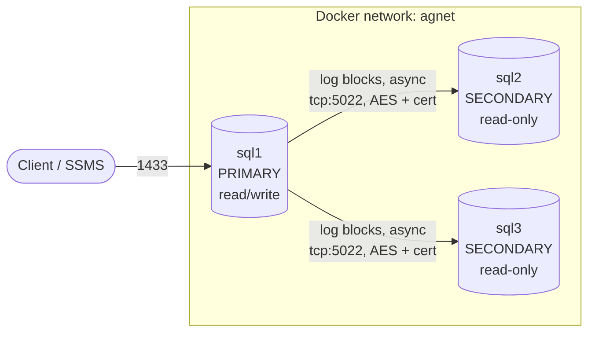

# SQL Server Always On Availability Group Lab

A 3-node SQL Server Always On Availability Group running in Linux containers on Docker. The lab
configures asynchronous replication with certificate-secured endpoints, then validates
failover end to end using only T-SQL: a planned failover with zero data loss, a simulated
primary crash with forced failover, re-seeding the crashed node, and failback.

**Stack:** Docker Compose, SQL Server 2025 on Linux (Ubuntu containers), T-SQL, Bash, sqlcmd



| Node | Host port | Initial role |
|------|-----------|--------------|
| sql1 | `localhost,14331` | Primary |
| sql2 | `localhost,14332` | Secondary (readable) |
| sql3 | `localhost,14333` | Secondary (readable) |

AG `ag1` | `CLUSTER_TYPE = NONE` | `ASYNCHRONOUS_COMMIT` | `SEEDING_MODE = AUTOMATIC` | database `SalesDB`

## Quick start

Requires Docker (Docker Desktop on Windows/macOS) with about 3 GB of free RAM, and a Bash shell
(Git Bash works on Windows).

```bash
cp .env.example .env          # then set your own passwords
bash scripts/setup.sh         # build the 3-node AG (about 2 minutes)
bash scripts/validate.sh      # run all replication + failover tests
bash scripts/status.sh        # roles, sync state, queues
bash scripts/teardown.sh      # remove everything
```

Individual operations:

```bash
bash scripts/planned-failover.sh sql2   # zero-data-loss failover to sql2
bash scripts/forced-failover.sh sql3    # kill the primary, force sql3 to take over
bash scripts/rejoin.sh sql2             # bring the crashed node back as a secondary
```

## How it is built, step by step

Every step is a plain T-SQL file in [`sql/`](sql), run by [`scripts/setup.sh`](scripts/setup.sh).
Each one is commented and safe to re-run.

| Step | Runs on | Script | What it does and why |
|------|---------|--------|----------------------|
| 1 | host | [`docker-compose.yml`](docker-compose.yml) | 3 containers with fixed hostnames (they become `@@SERVERNAME`, which the AG uses as the replica name) and `MSSQL_ENABLE_HADR=1` to enable the Always On feature. |
| 2 | all | [`01_prereqs.sql`](sql/01_prereqs.sql) | Database master key, plus the `dbm_login` / `dbm_user` principal that owns the endpoint certificate. Starts the `AlwaysOn_health` XEvent session. |
| 3 | sql1, then sql2/sql3 | [`02_create_certificate.sql`](sql/02_create_certificate.sql), [`03_import_certificate.sql`](sql/03_import_certificate.sql) | There is no Active Directory, so endpoints authenticate with a certificate. It is created on sql1, exported with `CERTENCODED()` / `CERTPRIVATEKEY()` as hex, and recreated on the others `FROM BINARY`. No key files are copied between containers. |
| 4 | all | [`04_create_endpoint.sql`](sql/04_create_endpoint.sql) | `DATABASE_MIRRORING` endpoint on TCP 5022 with certificate auth and `ENCRYPTION = REQUIRED ALGORITHM AES`. |
| 5 | sql1, then sql2/sql3 | [`05_create_ag.sql`](sql/05_create_ag.sql), [`06_join_ag.sql`](sql/06_join_ag.sql) | `CREATE AVAILABILITY GROUP` with 3 async replicas, readable secondaries and automatic seeding. Secondaries `JOIN` and get `GRANT CREATE ANY DATABASE` so seeding can create the DB. |
| 6 | sql1 | [`07_create_database.sql`](sql/07_create_database.sql) | `SalesDB` in FULL recovery, a full backup to start the log chain, then `ADD DATABASE` to the AG. Automatic seeding streams it to the secondaries. |
| 7 | primary | [`08_ag_health.sql`](sql/08_ag_health.sql) | Monitoring from `sys.dm_hadr_*` DMVs: role, connection, health, sync state, log send queue and redo queue. |

## Failover

`CLUSTER_TYPE = NONE` means there is no Windows Server Failover Cluster or Pacemaker, so
there is no automatic failover. Every role change is a manual T-SQL operation, and
`FORCE_FAILOVER_ALLOW_DATA_LOSS` is the only failover command available. Whether data is
actually lost depends on how you prepare for it. The procedures follow Microsoft's documented
steps for read-scale (clusterless) AGs.

### Planned failover, zero data loss ([`planned-failover.sh`](scripts/planned-failover.sh))

1. [`01_prepare_sync.sql`](sql/failover/01_prepare_sync.sql): switch the primary **and** the target to `SYNCHRONOUS_COMMIT` (a commit is only synchronous when both sides are), set `REQUIRED_SYNCHRONIZED_SECONDARIES_TO_COMMIT = 1`, then wait for the target to report `SYNCHRONIZED`.
2. [`02_offline.sql`](sql/failover/02_offline.sql): `ALTER AVAILABILITY GROUP ag1 OFFLINE` on the old primary and on the non-participating secondary. Writes stop, so the target cannot fall behind.
3. [`03_promote_target.sql`](sql/failover/03_promote_target.sql): `FORCE_FAILOVER_ALLOW_DATA_LOSS` on the target. This is safe here because the target was synchronized.
4. [`04_resume_secondary.sql`](sql/failover/04_resume_secondary.sql): `SET (ROLE = SECONDARY)` on the other replicas, then `SET HADR RESUME`.
5. [`05_restore_async.sql`](sql/failover/05_restore_async.sql): back to asynchronous commit for normal operation.

### Unplanned outage ([`forced-failover.sh`](scripts/forced-failover.sh) + [`rejoin.sh`](scripts/rejoin.sh))

1. `docker kill` the primary. This simulates power loss: no clean shutdown, and in-flight async log may never reach the secondaries.
2. Take the AG offline on the surviving secondary so it detaches from the dead primary.
3. `FORCE_FAILOVER_ALLOW_DATA_LOSS` on the chosen secondary, then [`REMOVE REPLICA`](sql/failover/06_remove_failed_replica.sql) for the dead node.
4. When the crashed node comes back **it still believes it is PRIMARY**. That is the split-brain risk of clusterless AGs. [`07_reset_old_primary.sql`](sql/failover/07_reset_old_primary.sql) drops its stale AG and its diverged copy of the database. [`08_add_replica.sql`](sql/failover/08_add_replica.sql) plus a `JOIN` re-adds it, and automatic seeding rebuilds it from the new primary.

## Validation results

[`scripts/validate.sh`](scripts/validate.sh) runs six tests and asserts row counts on every node
after every step. Full output: [`docs/validation-run.log`](docs/validation-run.log).
Setup output: [`docs/setup-run.log`](docs/setup-run.log).

| # | Test | Result |
|---|------|--------|
| 1 | 100 rows written on sql1 appear on sql2 and sql3 | PASS |
| 2 | Writes to sql2 / sql3 are rejected while they are secondaries | PASS |
| 3 | Planned failover sql1 to sql2, write 50 rows on sql2, replicated to sql1 and sql3 | PASS, 0 rows lost |
| 4 | `docker kill` primary sql2, forced failover to sql3, write 25 rows, replicated to sql1 | PASS, 0 rows lost |
| 5 | Restart sql2 (comes back as stale PRIMARY), reset, reseed, catches up | PASS |
| 6 | Planned failback to sql1, all 3 nodes have identical row counts | PASS |

Final state after the run: all replicas `CONNECTED` / `HEALTHY`, log send and redo queues at 0,
and rows tagged by the primary that wrote them (`sql1 105, sql2 50, sql3 25`). The whole suite
runs in about 3 minutes and passed on consecutive runs.

## Problems hit and how they were solved

- **SQL Server 2022 crashed during the endpoint handshake.** On Docker Desktop's WSL2 kernel 6.18, the 2022 image failed in its crypto layer (`EVP PKEY generate failed`, sporadic "error occurred while evaluating the password" logins, 100% CPU hangs) as soon as replicas connected on 5022. The 2025 image is stable on the same host. The image tag can be overridden with `MSSQL_TAG` in `.env`.
- **`Msg 35248` on the switch to synchronous commit.** Switching only the target to sync is not enough. The primary has to be synchronous too.
- **`Msg 41104` on `SET (ROLE = SECONDARY)`** while the AG was still online. For clusterless AGs you take the AG `OFFLINE` first, promote the target, and only then set the old primary to secondary.
- **Secondary stuck `NOT SYNCHRONIZING` after failover.** The new primary suspends data movement ("failover from partner") a moment *after* the secondary reconnects, so a single `HADR RESUME` can be issued too early. The resume script polls and re-resumes until movement stays active.
- **Stale primary after a crash.** With no cluster manager, nothing tells a recovered node it lost the primary role. It has to be fenced off (removed and reseeded) before it rejoins.

## Repository layout

```
docker-compose.yml        3 SQL Server containers on a private network
.env.example              passwords template (copy to .env, which is git-ignored)
sql/                      setup steps 01-08, one T-SQL file per step
sql/failover/             failover building blocks
scripts/lib.sh            shared helpers (sqlcmd wrappers, waits, checks)
scripts/setup.sh          builds the lab
scripts/validate.sh       end-to-end test suite
scripts/*.sh              planned-failover, forced-failover, rejoin, status, teardown
docs/                     captured output of setup and validation runs
```
